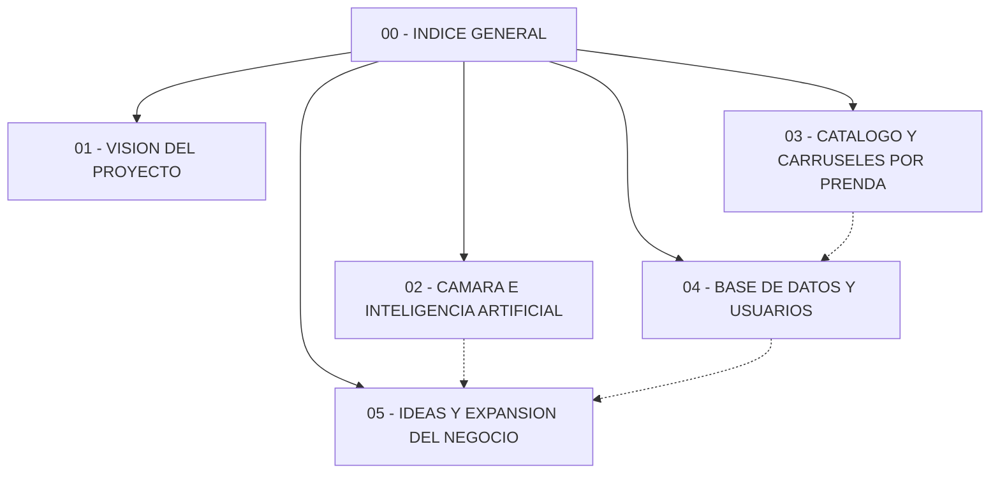

---
tags:
  - moc
  - taghers
  - streetwear
  - documentacion
fecha_creacion: 2026-10-09
estado: activo
---

# 🗺️ 00 - ÍNDICE GENERAL (Map of Content)

Bienvenido a la bóveda de documentación oficial del proyecto **TAGHER'S**. Esta carpeta está diseñada y estructurada específicamente para ser abierta y navegada en **Obsidian** mediante enlaces bidireccionales (`[[wikilinks]]`), etiquetas y diagramas interactivos.

---

## 🧭 Mapa de Navegación del Proyecto

---

## 📑 Módulos de Documentación

### 1. [[01 - VISION DEL PROYECTO]]
- Identidad de la marca **TAGHER'S** y estética de Figma.
- Filosofía de diseño: cortes Baggy, streetwear 90s/Y2K, contraste brutalista.
- Propuesta de valor: de tienda web a **software comercializable para marcas de ropa**.

### 2. [[02 - CAMARA E INTELIGENCIA ARTIFICIAL]]
- Cómo funciona el probador en vivo con **Google MediaPipe Pose** (cámara en cliente, 30-60 FPS, gratis).
- Cómo integrar **APIs de IA Generativa Fotorealista** (Fashn.ai, Replicate IDM-VTON, Fal.ai).
- Qué API pedir, cómo configurarla, parámetros de petición y costos por foto.

### 3. [[03 - CATALOGO Y CARRUSELES POR PRENDA]]
- Apartados individuales por prenda con **carruseles de 4 ángulos** (frente, dorso, modelo puesto en calle y detalle textil).
- Estructura de datos JSON y diseño de componentes para swipe táctil y miniaturas.

### 4. [[04 - BASE DE DATOS Y USUARIOS]]
- **Tablas exactas** que necesitas crear (`users`, `products`, `product_images`, `orders`, `order_items`, `wishlists`, `coupons`).
- Diagrama Entidad-Relación (ER).
- **Guía paso a paso de conexión**: cómo conectar la base de datos (con **Supabase**, **MySQL** o **SQLite**) hacia la web y el servidor.

### 5. [[05 - IDEAS Y EXPANSION DEL NEGOCIO]]
- Ideas extendidas no comentadas previamente:
  - 📲 **Checkout 1-click por WhatsApp** (para triplicar ventas en Latinoamérica).
  - 🤖 **Asesor Inteligente de Tallas con IA** (reduce devoluciones por error de talle).
  - 👕 **Armador de Outfits Interactivo (Lookbook)** con descuento por combo.
  - 🕶️ **Visor 3D y 360° para accesorios metálicos** con Three.js.
  - 🎟️ **Sistema de Drops y Preventas con Cuenta Regresiva (Hype Engine)**.
  - 💼 Modelos de cobro para vender la plataforma a marcas ($600 a $1.800 USD o SaaS mensual).

---

> [!TIP]
> En Obsidian, puedes presionar `Ctrl + O` (o `Cmd + O` en Mac) para buscar rápidamente cualquiera de estas notas por nombre o usar la vista de **Graph View** (`Ctrl + G`) para ver la red de notas interconectadas.
