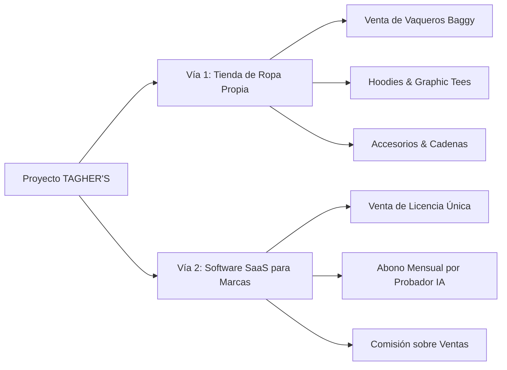

---
tags:
  - vision
  - marca
  - streetwear
  - modelo-negocio
fecha_creacion: 2026-10-09
relacionados:
  - "[[00 - INDICE GENERAL (MOC)]]"
  - "[[05 - IDEAS Y EXPANSION DEL NEGOCIO)]]"
---

# 🧢 01 - VISIÓN DEL PROYECTO: TAGHER'S

> [!NOTE]
> **TAGHER'S** nace de la fusión entre la cultura urbana contemporánea (skate, hip-hop, estética de los años 90 y el estilo Y2K) y la tecnología web interactiva de última generación.

---

## 🖤 1. Identidad de Marca y Estética Visual

El diseño original de la maqueta de Figma define una personalidad visual muy marcada:
- **Monocromía de Alto Contraste**: Uso dominante de negro puro (`#000000`), blanco tiza (`#FFFFFF`) y grises neutros (`#F4F4F4`), permitiendo que el color real lo aporten las prendas y las fotografías.
- **Tipografía Brutalista / Stencil**: Logo en mayúsculas rotundas con inspiración de marcas urbanas icónicas (Evisu, Southpole, Supreme, Stüssy).
- **Fotografía Callejera**: Fondos de asfalto, muros con grafiti, pistas de skate y modelos en plano entero.
- **Micro-interacciones y Tarjetas Redondeadas**: Esquinas suaves con radio de `16px` a `24px` que equilibran el tono rudo con un toque moderno y pulido.

---

## 🎯 2. Las Dos Vías de Negocio del Proyecto

### Vía 1: Tienda Propia de Ropa Urbana
- Venta de drops limitados de vaqueros anchos (*Baggy Denim*), sudaderas pesadas (*Heavyweight Hoodies*), camisetas gráficas oversize y accesorios metálicos (cadenas cubanas, anillos góticos, cinturones punk con tachas).

### Vía 2: Software Llave en Mano para Terceros (SaaS / White-Label)
- El sector de la moda online sufre una tasa de devoluciones del 30% al 45% debido a que los clientes no saben cómo les quedará la prenda o qué talle elegir.
- Ofrecer esta plataforma a otras marcas de indumentaria resuelve ese dolor de raíz gracias al:
  1. [[02 - CAMARA E INTELIGENCIA ARTIFICIAL|Probador Virtual con Cámara]]: Permite verse con la ropa en pantalla antes de pagar.
  2. [[03 - CATALOGO Y CARRUSELES POR PRENDA|Carruseles de 4 Ángulos]]: Claridad total sobre la caída del textil.
  3. [[04 - BASE DE DATOS Y USUARIOS|Gestión Centralizada]]: Perfil de clientes, historial de compras y lista de deseos.

---

## 🔗 Navegación Rápida
- Ir a [[00 - INDICE GENERAL (MOC)]]
- Siguiente módulo: [[02 - CAMARA E INTELIGENCIA ARTIFICIAL]]
