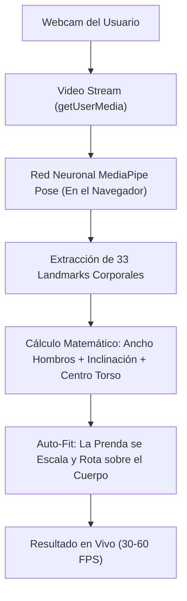

---
tags:
  - ia
  - probador-virtual
  - mediapipe
  - computer-vision
  - vton
  - api
fecha_creacion: 2026-10-09
relacionados:
  - "[[00 - INDICE GENERAL (MOC)]]"
  - "[[03 - CATALOGO Y CARRUSELES POR PRENDA]]"
  - "[[05 - IDEAS Y EXPANSION DEL NEGOCIO]]"
---

# 🤖 02 - CÁMARA E INTELIGENCIA ARTIFICIAL (VIRTUAL TRY-ON)

Uno de los mayores atractivos para venderle esta web a marcas de indumentaria es el **Probador Virtual**. Existen dos tecnologías complementarias para lograrlo:

1. **Nivel 1: IA en Tiempo Real en el Navegador (MediaPipe Pose)** — *Gratis, en vivo a 60 FPS, sin servidores*.
2. **Nivel 2: IA Generativa Fotorealista mediante API Externa (Diffusion VTON)** — *Genera fotos de estudio hiperrealistas con sombras y arrugas reales*.

---

## ⚡ NIVEL 1: IA en Tiempo Real con Google MediaPipe Pose

### ¿Cómo funciona?
En lugar de procesar imágenes pesadas en un servidor pago, **MediaPipe Pose** corre directamente en el chip gráfico del cliente (WebGL / WebAssembly). 



### Los Puntos Clave (Landmarks) que se Detectan:
MediaPipe identifica 33 puntos anatómicos. Para ropa urbana solo necesitamos 4 puntos principales:
- **Punto 11**: Hombro Izquierdo (`left_shoulder`).
- **Punto 12**: Hombro Derecho (`right_shoulder`).
- **Punto 23**: Cadera Izquierda (`left_hip`).
- **Punto 24**: Cadera Derecha (`right_hip`).

```
           [0] Nariz
              |
      [11] O======O [12]   <-- Distancia Hombro a Hombro (Define el Ancho de la Camiseta/Hoodie)
           |      |
           | Torso|        <-- Punto Medio: (P11 + P12) / 2 (Define el Centro del Pecho)
           |      |
      [23] O======O [24]   <-- Cintura y Comienzo de Vaqueros Baggy
           |      |
           |      |
```

### Algoritmo de Auto-Ajuste Matemático:
1. **Ancho y Escala de la Prenda**:
   $$\text{Ancho Hombros} = \sqrt{(x_{12} - x_{11})^2 + (y_{12} - y_{11})^2}$$
   Si el usuario se acerca o se aleja de la cámara, la prenda se agranda o achica automáticamente.
2. **Inclinación (Rotación)**:
   $$\theta = \arctan2(y_{12} - y_{11}, x_{12} - x_{11})$$
   Si el usuario inclina el cuerpo, la camiseta o campera se inclina con los mismos grados exactos.
3. **Posicionamiento**:
   El centro de la prenda se ancla en el punto medio entre ambos hombros descendiendo un 15% hacia el pecho.

> [!TIP]
> **Ventajas Clave**:
> - **Costo $0 USD**: No tienes que pagar ninguna cuota de suscripción a terceros.
> - **Inmediato**: El usuario se mueve y la ropa se mueve con él sin ningún retraso (*zero latency*).
> - **Privacidad Garantizada**: El video de la cámara jamás abandona la computadora o móvil del usuario.

---

## 🎨 NIVEL 2: IA Fotorealista con APIs Externas (Diffusion VTON)

Si quieres ofrecer a marcas una experiencia tipo *"Catálogo de Revista de Moda"*, donde la prenda se amolde al cuerpo generando arrugas reales de tela, pliegues y sombras naturales, se utilizan **Modelos de Difusión de Virtual Try-On (VTON)**.

### ¿Qué se le pide a la API y cómo funciona?
Para usar una API de IA necesitas enviar dos imágenes en formato HTTP POST:
1. **`person_image`**: Foto de la persona (selfie tomada con la cámara web o subida desde el móvil).
2. **`garment_image`**: Foto de la prenda con fondo blanco o recorte transparente.
3. **`category`**: `'tops'` (camisetas, sudaderas, chaquetas) o `'bottoms'` (vaqueros, jorts, pantalones).

La IA realiza un proceso de segmentación y difusión latente: borra la ropa vieja de la persona, proyecta la nueva tela respetando la iluminación del entorno y devuelve una fotografía final ultra realista en 4 a 7 segundos.

---

## 🏆 Comparativa de APIs: ¿Cuál Deberías Contratar?

Si decides incorporar una API de pago, estas son las 3 mejores opciones del mercado:

### 1. Fashn.ai (⭐ La más recomendada para ecommerce)
- **Sitio Web**: [https://fashn.ai](https://fashn.ai)
- **Especialidad**: Desarrollada exclusivamente para marcas de ropa.
- **Costo por generación**: **$0.05 a $0.07 USD** (~5 a 7 centavos de dólar por foto probada).
- **Tiempo de respuesta**: 4 a 6 segundos.
- **Lo que necesitas pedirles**: Una **API Key** desde su panel de control (`FASHN_API_KEY`).

#### Ejemplo de Código de Conexión (Node.js / Express):
```javascript
// server.js
const axios = require('axios');

async function runFashnTryOn(userPhotoBase64, garmentUrl, category = 'tops') {
  const response = await axios.post('https://api.fashn.ai/v1/run', {
    model_image: userPhotoBase64,
    garment_image: garmentUrl,
    category: category,
    mode: 'balanced', // 'fast', 'balanced' o 'quality'
    num_samples: 1
  }, {
    headers: {
      'Authorization': `Bearer ${process.env.FASHN_API_KEY}`,
      'Content-Type': 'application/json'
    }
  });

  // Retorna la URL de la imagen generada con la ropa puesta
  return response.data.output_image_url;
}
```

---

### 2. Replicate (Modelo IDM-VTON)
- **Sitio Web**: [https://replicate.com/cuuupid/idm-vton](https://replicate.com/cuuupid/idm-vton)
- **Especialidad**: El modelo open-source más premiado de la industria montado en la nube.
- **Costo por generación**: **$0.02 a $0.04 USD** por corrida (pago por segundo de GPU NVIDIA A100).
- **Tiempo de respuesta**: 6 a 10 segundos.
- **Lo que necesitas pedirles**: Crear cuenta en Replicate y obtener tu `REPLICATE_API_TOKEN`.

---

### 3. Fal.ai (IDM-VTON Ultra Fast)
- **Sitio Web**: [https://fal.ai/models/fal-ai/idm-vton](https://fal.ai/models/fal-ai/idm-vton)
- **Especialidad**: Velocidad extrema (inferencia en menos de 2.5 segundos).
- **Costo por generación**: ~$0.035 USD.

---

## 💼 Plan Estratégico Recomendado para Vender a Marcas

> [!IMPORTANT]
> **Estrategia Híbrida (La Mejor Jugada)**:
> 1. **Modo Gratuito en Vivo (MediaPipe)**: Siempre activo en la tienda para que cualquier usuario juegue con la cámara en vivo mientras explora productos sin que a la marca le cueste ni un centavo.
> 2. **Botón "Generar Foto de Catálogo con IA" (Fashn.ai)**: Disponible como función especial tras tomar la foto, o exclusivo para usuarios registrados. Cada usuario puede tener 3 créditos gratis por día y luego comprar un pack o registrarse.

---

## 🔗 Navegación Rápida
- Anterior: [[01 - VISION DEL PROYECTO]]
- Siguiente módulo: [[03 - CATALOGO Y CARRUSELES POR PRENDA]]
- Volver a: [[00 - INDICE GENERAL (MOC)]]
