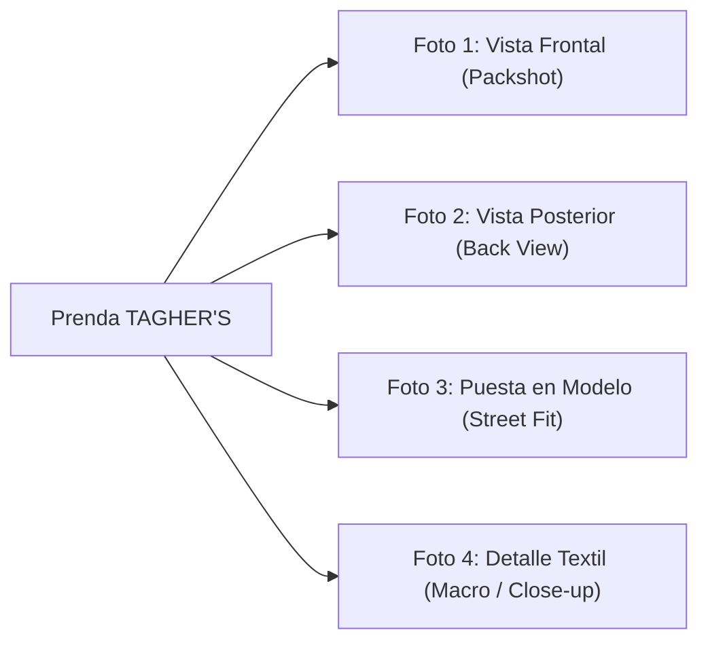

---
tags:
  - catalogo
  - carrusel
  - frontend
  - ui-ux
  - producto
fecha_creacion: 2026-10-09
relacionados:
  - "[[00 - INDICE GENERAL (MOC)]]"
  - "[[02 - CAMARA E INTELIGENCIA ARTIFICIAL]]"
  - "[[04 - BASE DE DATOS Y USUARIOS]]"
---

# 👕 03 - CATÁLOGO Y CARRUSELES POR PRENDA

En la venta online de indumentaria urbana (streetwear), mostrar una única fotografía frontal disminuye drásticamente la tasa de conversión. Los compradores de este estilo necesitan verificar:
1. **El corte real**: Cómo cae el tiro ancho del pantalón o los hombros caídos de la camiseta.
2. **El dorso**: Si hay serigrafías góticas, bordados de llamas o parches traseros.
3. **El outfit completo**: Cómo combina la prenda con zapatillas y accesorios en la calle.
4. **La calidad textil**: Si el algodón es pesado (280-380 gsm), el lavado a la piedra o las costuras dobles.

---

## 📸 Los 4 Ángulos Estratégicos del Carrusel

Cada prenda en el catálogo debe contar con su apartado dedicado con **4 fotografías clave**:



| Ángulo | Finalidad | Ejemplo |
|---|---|---|
| **1. Frontal** | Foto de portada limpia para la grilla de catálogo. | Prenda estirada en plano neutro. |
| **2. Trasero** | Destacar el diseño dorsal (estampas, bolsillos Evisu/Southpole). | Espalda del hoodie o tiro trasero del vaquero. |
| **3. En Modelo** | Enseñar cómo queda puesto en una persona real en movimiento. | Modelo en skatepark o calle con zapatillas retro. |
| **4. Detalle** | Generar confianza y justificar el precio premium. | Primer plano de la textura del denim o remaches. |

---

## 💻 Estructura de Datos (JSON / Base de Datos)

En el frontend o API, cada producto se representa con el siguiente esquema extendido:

```json
{
  "id": "vag-01",
  "name": "Southpole 90s Vintage Baggy Denim",
  "category": "vaqueros",
  "subCategory": "denim",
  "price": 75000,
  "oldPrice": 89000,
  "badge": "SOUTHPOLE VINTAGE",
  "stock": 45,
  "sizes": ["S", "M", "L", "XL", "XXL"],
  "specs": {
    "material": "100% Algodón Denim Premium",
    "peso": "14.5 oz (Heavyweight)",
    "lavado": "Stone Wash al ácido artesanal",
    "calce": "Ultra Baggy / Pierna ancha recta"
  },
  "images": [
    {
      "url": "https://images.unsplash.com/photo-1542272604-787c3835535d?w=800",
      "alt": "Vista frontal del vaquero Southpole Baggy",
      "angle": "front"
    },
    {
      "url": "https://images.unsplash.com/photo-1541099649105-f69ad21f3246?w=800",
      "alt": "Vista trasera con bolsillos bordados",
      "angle": "back"
    },
    {
      "url": "https://images.unsplash.com/photo-1515886657613-9f3515b0c78f?w=800",
      "alt": "Modelo vistiendo el corte baggy con zapatillas",
      "angle": "model"
    },
    {
      "url": "https://images.unsplash.com/photo-1584370848010-d7fe6bc767ec?w=800",
      "alt": "Primer plano de costuras y lavado vintage",
      "angle": "detail"
    }
  ],
  "overlayImage": "https://images.unsplash.com/photo-1542272604-787c3835535d?w=500",
  "overlayType": "bottom"
}
```

---

## 🎨 Componentes Visuales del Carrusel en Pantalla

El modal o página de producto incorpora los siguientes controles:

1. **Visor Principal con Zoom**:
   - Imagen en alta resolución en proporción `1:1.15`.
   - Efecto lupa al pasar el cursor para inspeccionar la trama textil.
2. **Flechas de Navegación Lateral**:
   - Botón `‹` y `›` para avanzar o retroceder fotos sin esfuerzo.
   - Soporte para deslizamiento táctil (*swipe*) en teléfonos móviles.
3. **Fila Inferior de Miniaturas (Thumbnails)**:
   - 4 pequeñas vistas previas de `60x60px`.
   - La foto activa se resalta con un borde negro de `2px` y escala de `1.05`.
   - Al hacer clic en cualquier miniatura, la foto principal cambia al instante con una animación suave de *fade-in*.
4. **Contador Numérico Discreto**:
   - Etiqueta pequeña superior derecha: `1 / 4`, `2 / 4`, etc.

---

## 🗃️ Relación con la Base de Datos Relacional

Este diseño se conecta de forma directa con las tablas explicadas en [[04 - BASE DE DATOS Y USUARIOS]]:
- La tabla `products` guarda los datos generales de la prenda (precio, stock, categoría).
- La tabla `product_images` almacena cada fotografía con su clave foránea `product_id`, su orden `sort_order` y su tipo de ángulo `view_angle`.

---

## 🔗 Navegación Rápida
- Anterior: [[02 - CAMARA E INTELIGENCIA ARTIFICIAL]]
- Siguiente módulo: [[04 - BASE DE DATOS Y USUARIOS]]
- Volver a: [[00 - INDICE GENERAL (MOC)]]
