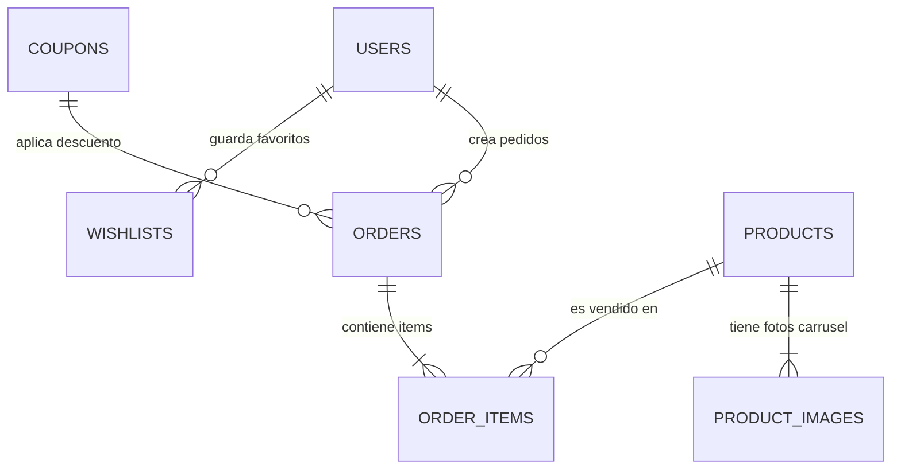
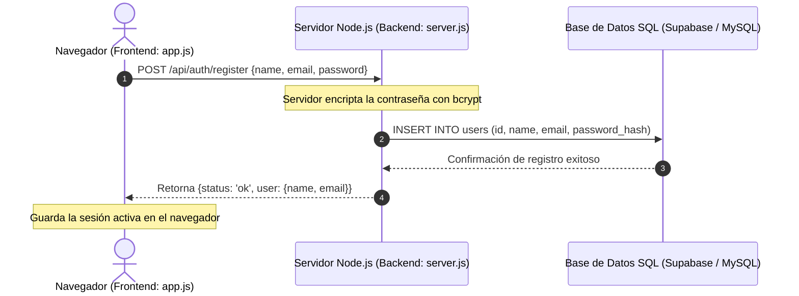

---
tags:
  - base-de-datos
  - sql
  - backend
  - usuarios
  - supabase
  - mysql
  - arquitectura
fecha_creacion: 2026-10-09
relacionados:
  - "[[00 - INDICE GENERAL (MOC)]]"
  - "[[03 - CATALOGO Y CARRUSELES POR PRENDA]]"
  - "[[05 - IDEAS Y EXPANSION DEL NEGOCIO]]"
---

# 🗄️ 04 - BASE DE DATOS Y SISTEMA DE USUARIOS

Para que una tienda online funcione en producción, no basta con guardar los datos en la memoria del navegador. Necesitamos una **Base de Datos Relacional (SQL)** que almacene de forma segura a los clientes, sus contraseñas encriptadas, el catálogo de prendas, el stock y cada pedido realizado.

En este documento tienes:
1. **Las 7 tablas exactas** que debes crear con sus campos y relaciones.
2. **Cómo funciona la arquitectura de conexión** (Frontend ➔ Backend ➔ Base de Datos).
3. **Paso a paso de cómo conectar tu base de datos** (utilizando **Supabase** en la nube o **MySQL** local).

---

## 📋 1. Las Tablas Exactas que Deberías Poner



A continuación tienes el detalle de cada tabla:

### Tabla 1: `users` (Cuentas de Usuarios y Perfiles)
Guarda la identidad de clientes y administradores.
- `id` (VARCHAR 36): Identificador único (UUID).
- `name` (VARCHAR 100): Nombre completo.
- `email` (VARCHAR 150, UNIQUE): Correo electrónico del usuario.
- `password_hash` (VARCHAR 255): Contraseña cifrada de forma segura (con bcrypt o argon2). *Nunca guardes contraseñas en texto plano*.
- `role` (VARCHAR 20): `'customer'` (cliente común) o `'admin'` (dueño de la tienda).
- `phone` (VARCHAR 30, Opcional): Teléfono para notificaciones de entrega por WhatsApp.
- `created_at` (TIMESTAMP): Fecha y hora de creación de la cuenta.

### Tabla 2: `products` (Catálogo de Ropa y Accesorios)
- `id` (VARCHAR 50, PK): Código de producto (ej. `vag-01`, `tee-02`).
- `name` (VARCHAR 150): Nombre de la prenda (ej. *"Southpole 90s Vintage Baggy Denim"*).
- `category` (VARCHAR 50): Categoría principal (`'vaqueros'`, `'camisetas'`, `'sudaderas'`, `'accesorios'`).
- `sub_category` (VARCHAR 50): Subcategoría (`'denim'`, `'hoodies'`, `'cadenas'`, `'anillos'`, `'cinturones'`).
- `price` (DECIMAL 10,2): Precio en moneda local o dólares.
- `old_price` (DECIMAL 10,2, Opcional): Precio original antes de rebajas (para tacharlo).
- `stock` (INT): Cantidad de unidades disponibles en almacén.
- `badge` (VARCHAR 50): Etiqueta visual (`'SOUTHPOLE'`, `'TOP SELLER'`, `'DROP EXCLUSIVO'`).
- `description` (TEXT): Descripción detallada del calce, composición y tela.
- `overlay_type` (VARCHAR 20): Tipo de prenda para el probador virtual (`'top'`, `'bottom'`, `'accessory'`).
- `is_offer` (BOOLEAN): Define si aparece en la sección de ofertas.

### Tabla 3: `product_images` (Fotos para el Carrusel)
Permite que cada prenda tenga sus 4 imágenes del carrusel vinculadas.
- `id` (INT AUTO_INCREMENT, PK).
- `product_id` (VARCHAR 50, FK): Vinculado a `products.id`.
- `image_url` (TEXT): Enlace o ruta de la foto en alta resolución.
- `view_angle` (VARCHAR 30): Ángulo de la foto (`'front'`, `'back'`, `'model'`, `'detail'`).
- `is_primary` (BOOLEAN): Si es la foto de portada.
- `sort_order` (INT): Orden dentro del carrusel (1, 2, 3, 4).

### Tabla 4: `orders` (Órdenes de Compra)
- `id` (VARCHAR 30, PK): Número de seguimiento visible (ej. `#TAG-7841`).
- `user_id` (VARCHAR 36, FK, Nullable): Usuario que hizo la compra (o nulo si compró como invitado).
- `customer_name` (VARCHAR 100): Nombre de la persona que recibe el paquete.
- `customer_phone` (VARCHAR 30): Teléfono de contacto para el transportista.
- `shipping_address` (VARCHAR 255): Dirección exacta (calle, número, depto).
- `city` (VARCHAR 100): Ciudad o localidad.
- `postal_code` (VARCHAR 20): Código postal.
- `total` (DECIMAL 10,2): Importe final abonado.
- `coupon_code` (VARCHAR 30, FK, Nullable): Código de descuento utilizado.
- `payment_method` (VARCHAR 50): Método (`'card'`, `'mercadopago'`, `'transfer'`).
- `status` (VARCHAR 30): Estado del pedido (`'En preparación'`, `'Despachado'`, `'Entregado'`, `'Cancelado'`).
- `created_at` (TIMESTAMP): Momento exacto de compra.

### Tabla 5: `order_items` (Prendas dentro de cada Pedido)
- `id` (INT AUTO_INCREMENT, PK).
- `order_id` (VARCHAR 30, FK): Vinculado a `orders.id`.
- `product_id` (VARCHAR 50, FK): Prenda comprada.
- `size` (VARCHAR 10): Talla elegida (`'S'`, `'M'`, `'L'`, `'XL'`, etc.).
- `quantity` (INT): Cantidad de unidades.
- `unit_price` (DECIMAL 10,2): Precio unitario congelado al momento del pago.

### Tabla 6: `wishlists` (Prendas Guardadas en Favoritos)
- `id` (INT AUTO_INCREMENT, PK).
- `user_id` (VARCHAR 36, FK): Usuario que guardó la prenda.
- `product_id` (VARCHAR 50, FK): Prenda marcada con corazón.

### Tabla 7: `coupons` (Cupones de Descuento)
- `code` (VARCHAR 30, PK): Código que tipea el cliente (ej. `TAGHERS10`).
- `discount_rate` (DECIMAL 3,2): Porcentaje de rebaja (ej. `0.10` = 10% OFF).
- `is_active` (BOOLEAN): Activo o deshabilitado.

---

## 🔌 2. ¿Cómo se Conecta la Base de Datos a la Web?

Un error común de principiante es intentar conectar la base de datos directamente desde el archivo `app.js` en el navegador. **Nunca se hace eso** porque cualquiera podría abrir la consola y ver las contraseñas de la base de datos.

La conexión correcta funciona en **3 capas seguras**:



---

## 🚀 3. Guía Paso a Paso para Conectarla (Opción Recomendada: Supabase)

**Supabase** es la mejor opción actual para este proyecto: te da una base de datos PostgreSQL completa en la nube sin costo alguno, con panel visual y panel de usuarios listo.

### Paso 1: Crear tu Proyecto en Supabase
1. Ingresa en [https://supabase.com](https://supabase.com) y crea tu cuenta gratuita.
2. Presiona en **"New Project"**.
3. Ponle de nombre `taghers-streetwear` y elige una contraseña segura.

### Paso 2: Crear las Tablas en 1 Clic con el SQL
1. En el menú lateral izquierdo de Supabase, haz clic en **"SQL Editor"** (icono de terminal `>_`).
2. Presiona el botón verde **"New query"**.
3. Abre el archivo `schema.sql` que creamos en la raíz de tu proyecto, copia todo el texto y pégalo allí.
4. Presiona el botón **"Run"**.
5. ¡Listo! Si vas a **"Table Editor"**, verás todas tus tablas (`users`, `products`, `orders`, etc.) perfectamente estructuradas.

### Paso 3: Obtener las Credenciales de Conexión
1. En Supabase ve a **Project Settings > API**.
2. Copia estos dos valores:
   - **Project URL** (ejemplo: `https://abcdefgh.supabase.co`)
   - **Anon / Public Key** (clave de acceso)

### Paso 4: Vincularlo en el Servidor (`server.js`)
En tu proyecto instalas el conector de Supabase:
```bash
npm install @supabase/supabase-js
```

Y en tu archivo de servidor (`server.js`) colocas la conexión:
```javascript
const { createClient } = require('@supabase/supabase-js');

const SUPABASE_URL = 'https://tu-proyecto.supabase.co';
const SUPABASE_KEY = 'tu-clave-anon-aqui';
const db = createClient(SUPABASE_URL, SUPABASE_KEY);

// Ejemplo: Endpoint para registrar un usuario real en la base de datos
app.post('/api/auth/register', async (req, res) => {
  const { name, email, password } = req.body;

  // 1. Registrar usuario en la tabla de Supabase
  const { data, error } = await db
    .from('users')
    .insert([
      { name, email, password_hash: hashPassword(password) }
    ]);

  if (error) return res.status(400).json({ error: error.message });
  res.json({ message: 'Usuario registrado con éxito', user: data });
});
```

### Paso 5: Cómo lo llama el Frontend (`app.js`)
Cuando el cliente presiona el botón de *"Crear Cuenta"*, el archivo `app.js` solo hace esta llamada:
```javascript
async function registerUser(name, email, password) {
  const response = await fetch('/api/auth/register', {
    method: 'POST',
    headers: { 'Content-Type': 'application/json' },
    body: JSON.stringify({ name, email, password })
  });

  const result = await response.json();
  console.log('Respuesta de la Base de Datos:', result);
}
```

---

## 🔗 Navegación Rápida
- Anterior: [[03 - CATALOGO Y CARRUSELES POR PRENDA]]
- Siguiente módulo: [[05 - IDEAS Y EXPANSION DEL NEGOCIO]]
- Volver a: [[00 - INDICE GENERAL (MOC)]]
