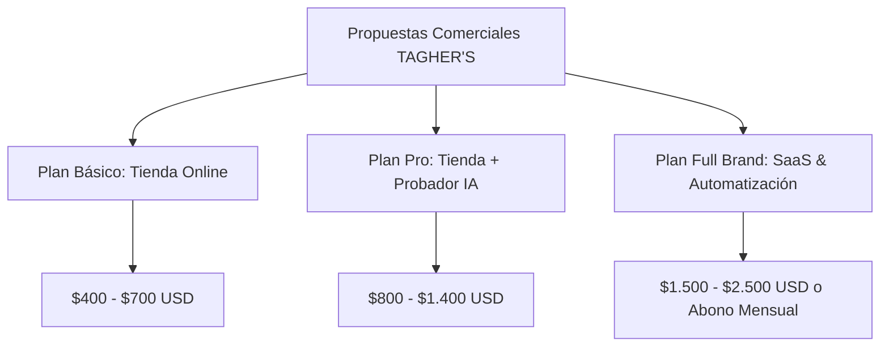

---
tags:
  - ideas
  - negocio
  - saas
  - marketing
  - roadmap
  - streetwear
fecha_creacion: 2026-10-09
relacionados:
  - "[[00 - INDICE GENERAL (MOC)]]"
  - "[[01 - VISION DEL PROYECTO]]"
  - "[[02 - CAMARA E INTELIGENCIA ARTIFICIAL]]"
  - "[[04 - BASE DE DATOS Y USUARIOS]]"
---
/brouser
# 🚀 05 - IDEAS Y EXPANSIÓN DEL NEGOCIO (ROADMAP ESTRATÉGICO)

Si tu meta es **venderle esta solución a marcas de ropa, tiendas independientes, diseñadores o showrooms**, necesitas ofrecer funciones que resuelvan sus mayores problemas comerciales:
- Bajar la tasa de devoluciones por error de talle.
- Aumentar el ticket promedio de compra por cliente.
- Automatizar ventas directas sin depender de responder mensajes manuales durante horas.

A continuación tienes un repertorio de **ideas de alto valor** recomendadas para enriquecer tu plan:

---

## 💡 1. Nuevas Funcionalidades Comerciales Recomendadas

### 📲 Idea A: Checkout Directo por WhatsApp ("1-Click Buy")
En los mercados de habla hispana, una gran cantidad de compradores no completan pagos con tarjeta o prefieren coordinar transferencias directas con el dueño de la marca.
- **Cómo funciona**: En el carrito o en la ficha de cada prenda, agregamos un botón destacado verde:
  `[💬 COMPRAR POR WHATSAPP]`.
- Al presionarlo, el sistema toma automáticamente el producto, la talla elegida, el precio total y la dirección del cliente, abriendo WhatsApp con este mensaje listo para enviar:
  > *"¡Hola TAGHER'S! 👋 Quiero encargar este pedido:\n• 1x Southpole 90s Vintage Baggy Denim (Talla L) - $75.000\n• 1x Cuban Link Chunky Silver Chain - $32.000\nTotal con descuento: $96.300\nDirección de envío: Av. Corrientes 1420, CABA.\n¿Me pasan los datos para transferir?"*
- **Beneficio para quien compre la web**: Cero fricción de pago, atención personalizada y aumento de hasta un 40% en ventas cerradas.

---

### 🤖 Idea B: Asesor Inteligente de Talla con IA ("Smart Size Fit")
El corte *Baggy* genera muchas dudas entre los clientes (¿me quedará muy gigante?, ¿el tiro será muy largo?).
- **Cómo funciona**: Un modal rápido de 3 preguntas:
  1. Tu estatura (ej. `1.78 m`).
  2. Tu peso aproximado (ej. `74 kg`).
  3. ¿Cómo te gusta que te quede?: `Ultra Baggy (muy suelto)` / `Relaxed (holgado estándar)` / `Regular`.
- Un algoritmo heurístico calcula y responde al instante:
  > *"Para tu contextura y un estilo Baggy auténtico, tu talle perfecto es **L**. Si prefieres que caiga justo sobre tus zapatillas sin pisarlo, elige **M**."*
- **Beneficio**: Reduce drásticamente las devoluciones y reclamos post-venta.

---

### 🧥 Idea C: Creador de Outfits Interactivo ("Arma tu Look Streetwear")
En lugar de vender una sola prenda de $35.000, vendes el conjunto completo de $160.000.
- **Cómo funciona**: Una pantalla dividida en 3 bloques visuales interactivos:
  1. **Selector Superior**: Eliges entre Camisetas o Hoodies.
  2. **Selector Inferior**: Eliges entre Vaqueros Baggy o Cargos.
  3. **Selector de Accesorios**: Eliges entre Cadenas cubanas, Anillos o Cinturones.
- El cliente ve cómo combinan los tres elementos juntos en pantalla.
- **Incentivo**: Botón *"Comprar Look Completo"* con un **15% de descuento especial por combo**.

---

### 💍 Idea D: Visor 3D y 360° para Accesorios (Three.js / WebGL)
Para la sección de **Accesorios Metálicos** (anillo de calavera macizo, sello con piedra rubí, hebilla de cinturón punk con tachas):
- Un visor 3D interactivo donde el usuario pueda rotar el anillo con el dedo en el móvil o con el mouse en la computadora, apreciando los reflejos metálicos y detalles grabados.
- Se implementa fácilmente con librerías livianas como `<model-viewer>` de Google o Three.js.

---

### ⏳ Idea E: Sistema de "Drops Exclusivos" con Cuenta Regresiva (Hype Engine)
La cultura del streetwear se mueve por la escasez y el *hype*.
- Barra superior o pop-up con contador regresivo en vivo:
  > *"🚨 PRÓXIMO DROP LIMITADO: 48 HORAS PARA EL LANZAMIENTO"*.
- Sistema de **Acceso VIP por Correo**: Los usuarios registrados reciben acceso 2 horas antes de que el público general pueda ver el stock.
- Indicador dinámico de stock restante (*"¡Quedan solo 3 unidades en talla XL!"*).

---

### 📦 Idea F: Generador Automático de Etiquetas de Envío en PDF
Una herramienta pensada para el dueño de la marca en su panel de administración:
- Con 1 solo clic sobre una orden completada, el sistema genera la etiqueta de despacho lista para imprimir con los datos del destinatario, código de barras y formato estándar para empresas de paquetería (Andreani, Correo Argentino, OCA, DHL, FedEx).

---

## 💰 2. Paquetes Comerciales para Vender la Plataforma

Cuando te reúnas con marcas de ropa o diseñadores para presentarles la tienda, puedes ofrecerles 3 propuestas estructuradas:

### 1. Plan Básico: Tienda Web Urbana ($400 a $700 USD)
- Catálogo completo por categorías.
- Carruseles multi-ángulo por prenda.
- Carrito y Checkout integrado con WhatsApp y Mercado Pago.
- Diseño responsive adaptado a la identidad de la marca.

### 2. Plan Pro: Tienda + Probador Virtual con IA ($800 a $1.400 USD)
- Todo lo del Plan Básico.
- **Probador Virtual con Cámara en tiempo real (MediaPipe Pose)**.
- Ajuste automático de prendas sobre el cuerpo.
- Captura de fotos y marcas de agua de la marca para viralizar en redes sociales.

### 3. Plan Full Brand: Ecosistema Completo ($1.500+ USD o $80 USD/mes)
- Todo lo del Plan Pro.
- Base de datos conectada en la nube con Supabase.
- Panel de administración para subir stock sin saber programar.
- Conexión opcional con API de IA fotorealista (Fashn.ai).
- Soporte técnico y hosting administrado.

---

## 🔗 Navegación Rápida
- Anterior: [[04 - BASE DE DATOS Y USUARIOS]]
- Volver al inicio: [[00 - INDICE GENERAL (MOC)]]
- Ver visión: [[01 - VISION DEL PROYECTO]]
