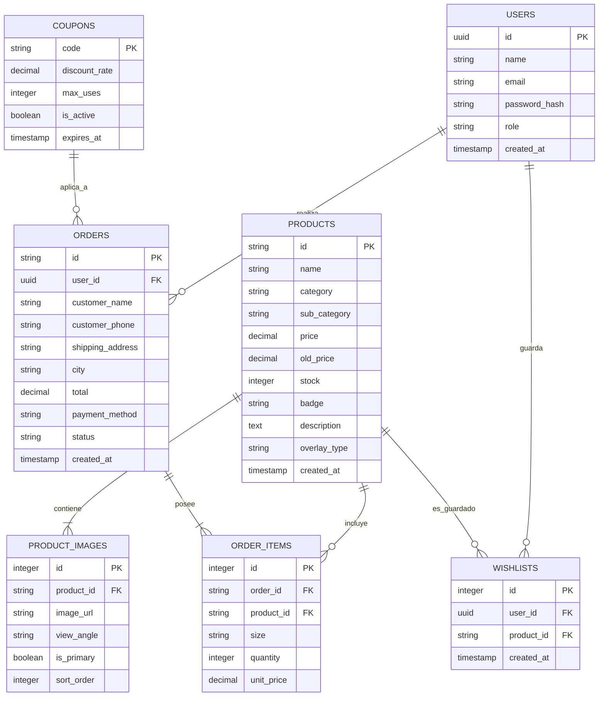

# 📐 Arquitectura del Sistema y Base de Datos

En este documento se describe el modelo de datos relacional de **TAGHER'S**, las tablas indispensables para la plataforma, la especificación de la API REST y las instrucciones detalladas para conectar bases de datos en la nube o locales.

---

## 🗄️ Modelo de Base de Datos Relacional (Tablas SQL)

Para soportar usuarios, catálogo extendido con múltiples fotos, carrito, cupones y órdenes de compra, se definen las siguientes **7 tablas fundamentales**:



---

## 📋 Detalle de Tablas y Atributos

### 1. `users` (Usuarios y Autenticación)
Almacena las cuentas de clientes y administradores.
- `id` (VARCHAR/UUID, Clave Primaria): Identificador único del usuario.
- `name` (VARCHAR 100): Nombre completo del cliente.
- `email` (VARCHAR 150, UNIQUE): Correo electrónico para inicio de sesión.
- `password_hash` (VARCHAR 255): Contraseña cifrada (usando bcrypt o argon2).
- `role` (VARCHAR 20): `'customer'` o `'admin'`.
- `phone` (VARCHAR 30): Teléfono de contacto para el delivery.
- `created_at` (TIMESTAMP): Fecha y hora de registro.

### 2. `products` (Prendas y Accesorios)
Registra el inventario de la tienda.
- `id` (VARCHAR 50, Clave Primaria): Código de producto (ej. `vag-01`, `tee-02`).
- `name` (VARCHAR 150): Nombre comercial de la prenda.
- `category` (VARCHAR 50): Categoría raíz (`'vaqueros'`, `'camisetas'`, `'sudaderas'`, `'accesorios'`).
- `sub_category` (VARCHAR 50): Subcategoría (`'denim'`, `'hoodies'`, `'cadenas'`, `'anillos'`).
- `price` (DECIMAL 10,2): Precio de venta actual.
- `old_price` (DECIMAL 10,2, Nullable): Precio anterior para mostrar tachado si hay descuento.
- `stock` (INTEGER): Cantidad disponible en almacén.
- `badge` (VARCHAR 50): Etiqueta promocional (`'SOUTHPOLE'`, `'TOP SELLER'`, `'EDICIÓN LIMITADA'`).
- `description` (TEXT): Descripción de corte, composición textil y calce.
- `overlay_type` (VARCHAR 20): Posición para el probador virtual (`'top'`, `'bottom'`, `'accessory'`).

### 3. `product_images` (Carrusel Multi-Ángulo)
Permite que cada prenda tenga tantas fotografías como se desee para el carrusel interactivo.
- `id` (INTEGER AUTO_INCREMENT, Clave Primaria).
- `product_id` (VARCHAR 50, Clave Foránea referenciando a `products.id`).
- `image_url` (TEXT): Enlace o ruta de la imagen en alta definición.
- `view_angle` (VARCHAR 50): Ángulo (`'front'`, `'back'`, `'model'`, `'detail'`).
- `is_primary` (BOOLEAN): Si es la foto de portada para la tarjeta de producto.
- `sort_order` (INTEGER): Orden en el carrusel (1, 2, 3, 4).

### 4. `orders` (Órdenes de Compra)
- `id` (VARCHAR 30, Clave Primaria): Código de seguimiento público (ej. `#TAG-8492`).
- `user_id` (VARCHAR/UUID, Nullable): Clave Foránea del usuario si compró registrado.
- `customer_name` (VARCHAR 100): Nombre de quien recibe el envío.
- `customer_phone` (VARCHAR 30): Teléfono de entrega.
- `shipping_address` (VARCHAR 255): Dirección de destino.
- `city` (VARCHAR 100): Ciudad o provincia.
- `postal_code` (VARCHAR 20): Código postal.
- `total` (DECIMAL 10,2): Monto final pagado con descuentos aplicados.
- `payment_method` (VARCHAR 50): `'card'`, `'mercadopago'`, `'transfer'`.
- `status` (VARCHAR 30): `'En preparación'`, `'Despachado'`, `'Entregado'`, `'Cancelado'`.
- `created_at` (TIMESTAMP): Fecha y hora del pedido.

### 5. `order_items` (Detalle de Prendas por Pedido)
- `id` (INTEGER AUTO_INCREMENT, Clave Primaria).
- `order_id` (VARCHAR 30, Clave Foránea a `orders.id`).
- `product_id` (VARCHAR 50, Clave Foránea a `products.id`).
- `size` (VARCHAR 10): Talla elegida (`'S'`, `'M'`, `'L'`, `'XL'`, etc.).
- `quantity` (INTEGER): Unidades compradas.
- `unit_price` (DECIMAL 10,2): Precio unitario al momento de la compra.

### 6. `wishlists` (Prendas Guardadas / Favoritos)
- `id` (INTEGER AUTO_INCREMENT, Clave Primaria).
- `user_id` (VARCHAR/UUID, Clave Foránea a `users.id`).
- `product_id` (VARCHAR 50, Clave Foránea a `products.id`).
- `created_at` (TIMESTAMP).

### 7. `coupons` (Cupones de Descuento)
- `code` (VARCHAR 30, Clave Primaria): Código ingresado por el usuario (ej. `TAGHERS10`).
- `discount_rate` (DECIMAL 3,2): Fracción de descuento (ej. `0.10` para 10%).
- `is_active` (BOOLEAN): Si se encuentra vigente.
- `expires_at` (TIMESTAMP, Nullable): Fecha límite de validez.

---

## 🔗 Cómo Conectar la Base de Datos Paso a Paso

Te recomendamos dos opciones según tu necesidad: **Opción A (Supabase)** si quieres una base de datos en la nube gratuita lista en 5 minutos, u **Opción B (MySQL local / XAMPP)** si prefieres trabajar 100% en tu máquina.

---

### Opción A: Supabase (PostgreSQL en la Nube Gratuito - ⭐ RECOMENDADA)

Supabase te da una base de datos PostgreSQL completa sin costo, con panel web, autenticación y API lista.

1. **Crear cuenta**: Ve a [https://supabase.com](https://supabase.com) y crea una cuenta gratuita.
2. **Crear proyecto**: Haz clic en **"New Project"**, nómbralo `taghers-db` y asigna una contraseña.
3. **Ejecutar el esquema**:
   - En el menú lateral de Supabase, entra a **SQL Editor**.
   - Haz clic en **New query**.
   - Copia todo el contenido del archivo [schema.sql](file:///c:/Users/User/Documents/ROPA/schema.sql) y pégalo allí.
   - Presiona el botón verde **Run**. ¡Todas tus tablas quedarán creadas automáticamente con índices y relaciones!
4. **Obtener las claves de conexión**:
   - Ve a **Settings > API**.
   - Copia la **Project URL** (ej. `https://xyzcompany.supabase.co`) y la **Anon Public Key**.
5. **Vincular a la tienda**:
   - Puedes colocar esas claves en tu archivo de configuración o en el backend `server.js` utilizando la librería oficial `@supabase/supabase-js`.

Ejemplo de conexión en Node.js (`server.js`):
```javascript
const { createClient } = require('@supabase/supabase-js');

const SUPABASE_URL = 'https://tu-proyecto.supabase.co';
const SUPABASE_KEY = 'tu-clave-anon-aqui';
const supabase = createClient(SUPABASE_URL, SUPABASE_KEY);

// Ejemplo: Obtener todos los productos con sus fotos
async function getProducts() {
  const { data, error } = await supabase
    .from('products')
    .select(`
      *,
      product_images (*)
    `);
  return data;
}
```

---

### Opción B: MySQL Local (XAMPP / Laragon / Workbench)

Si prefieres tener MySQL en tu computadora:

1. **Iniciar MySQL**: Abre XAMPP o Laragon y presiona **Start** en el servicio de MySQL.
2. **Entrar a phpMyAdmin**: Abre en tu navegador `http://localhost/phpmyadmin`.
3. **Crear Base de Datos**: Crea una base de datos llamada `taghers_store` con cotejamiento `utf8mb4_unicode_ci`.
4. **Importar Tablas**:
   - Ve a la pestaña **Importar** (o pestaña **SQL**).
   - Abre el archivo [schema.sql](file:///c:/Users/User/Documents/ROPA/schema.sql), copia el contenido y ejecútalo.
5. **Conectar en Node.js**:
   Instala el driver: `npm install mysql2` y configura la conexión:
   ```javascript
   const mysql = require('mysql2/promise');

   const pool = mysql.createPool({
     host: 'localhost',
     user: 'root',
     password: '',
     database: 'taghers_store',
     waitForConnections: true,
     connectionLimit: 10
   });
   ```

---

### Opción C: SQLite Embebido (Sin instalar nada, 100% automático)

El servidor `server.js` incluye un motor de datos integrado basado en persistencia JSON/SQLite que guarda los usuarios, carritos y órdenes directamente en la carpeta local del proyecto sin que tengas que instalar ningún programa extra.

---

## 📡 Endpoints de la API REST

El servidor expone las siguientes rutas:

| Método | Endpoint | Descripción | Body Requerido |
|---|---|---|---|
| `GET` | `/api/products` | Devuelve el catálogo completo con imágenes | Ninguno |
| `GET` | `/api/products/:id` | Devuelve el detalle de un producto específico | Ninguno |
| `POST` | `/api/auth/register` | Registra una nueva cuenta de usuario | `{ name, email, password }` |
| `POST` | `/api/auth/login` | Inicia sesión y devuelve token/usuario | `{ email, password }` |
| `GET` | `/api/user/profile` | Consulta datos del perfil y órdenes activas | Header `Authorization` |
| `POST` | `/api/orders/create` | Registra un pedido completado | `{ customerName, phone, address, items, total, paymentMethod }` |
| `GET` | `/api/orders/:id` | Rastreo del estado de un pedido | Ninguno |
