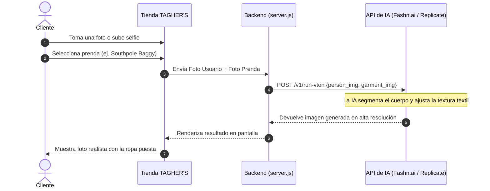

# 🤖 Probador Virtual e Inteligencia Artificial (Virtual Try-On)

El probador virtual es la funcionalidad diferencial clave de **TAGHER'S**. En este documento se explica cómo opera tanto la tecnología en tiempo real basada en **MediaPipe Pose** como las opciones de **APIs de Inteligencia Artificial Generativa (Diffusion VTON)** para renders fotorealistas.

---

## ⚡ 1. Probador en Tiempo Real con MediaPipe Pose (En el Navegador)

La solución integrada por defecto en la tienda corre **100% en el dispositivo del cliente**, utilizando aceleración por hardware (WebGL y WebAssembly).

### ¿Cómo funciona la detección de postura?

1. **Captura de Fotogramas**: El navegador solicita acceso a la webcam mediante `navigator.mediaDevices.getUserMedia()`.
2. **Inferencia con Red Neuronal**: Cada fotograma del video es procesado en microsegundos por el modelo de **MediaPipe Pose**.
3. **Puntos Clave (Landmarks Anatómicos)**:
   - **Hombro Izquierdo (Landmark 11)** y **Hombro Derecho (Landmark 12)**.
   - **Pecho / Clavícula** (Punto medio entre ambos hombros).
   - **Cadera Izquierda (Landmark 23)** y **Cadera Derecha (Landmark 24)**.
   - **Nariz y Cuello** para orientación de collares y cadenas.

```
       [0] Nariz
          \
   [11] O====*====O [12]  <-- Ancho de Hombros y Ángulo de Inclinación
        |    |    |
        |  Torso  |       <-- Escala y Posición de Camiseta / Hoodie
        |    |    |
   [23] O====*====O [24]  <-- Ancho de Cintura y Comienzo de Vaqueros Baggy
        |         |
        | Piernas |       <-- Escala y Largo de Pantalón
```

### Ventajas de este enfoque:
- **Costo Cero ($0.00)**: No pagas servidores ni créditos de API por cada usuario que abra la cámara.
- **Sin Latencia (30-60 FPS)**: La prenda se mueve, inclina y ajusta instantáneamente cuando la persona se mueve.
- **Privacidad Total**: El video de la cámara jamás viaja por internet; se procesa de forma segura en la memoria RAM del usuario.

---

## 🎨 2. Probador Fotorealista con APIs de IA Generativa (VTON - Virtual Try-On)

A diferencia del seguimiento en vivo de la cámara, los modelos generativos de difusión (como **IDM-VTON** o **OOTDiffusion**) toman dos imágenes estáticas y generan una nueva foto donde la tela se adapta con arrugas, sombras y pliegues naturales como si fuera una sesión fotográfica de estudio.

### Flujo de Funcionamiento:


---

## 💡 Comparativa de Proveedores de APIs de IA para Virtual Try-On

Si deseas vender la tienda a clientes corporativos que busquen acabado fotorealista de catálogo, estas son las mejores opciones disponibles en el mercado:

### 1. Fashn.ai (Especializada en Moda)
- **Sitio Web**: [https://fashn.ai](https://fashn.ai)
- **Calidad**: Muy alta. Reconoce partes superiores, inferiores (pantalones) y vestidos.
- **Tiempo de respuesta**: ~4 a 7 segundos.
- **Precio aproximado**: ~$0.05 a $0.09 dólares por generación.
- **Fácil integración**: Tienen SDK oficial en Node.js y Python.

### 2. Replicate (Modelo IDM-VTON)
- **Sitio Web**: [https://replicate.com/cuuupid/idm-vton](https://replicate.com/cuuupid/idm-vton)
- **Calidad**: Estado del arte en código abierto. Maneja arrugas de tela excelentes.
- **Tiempo de respuesta**: ~6 a 10 segundos.
- **Precio aproximado**: ~$0.02 a $0.04 dólares por generación.

### 3. Fal.ai (Ultra Rápido)
- **Sitio Web**: [https://fal.ai/models/fal-ai/idm-vton](https://fal.ai/models/fal-ai/idm-vton)
- **Calidad**: Muy alta con tiempos de inferencia optimizados de menos de 3 segundos.

---

## 🛠️ Cómo Conectar una API de IA en el Proyecto

En `server.js` hemos preparado la estructura para habilitar el endpoint de generación fotorealista:

```javascript
// server.js (Ejemplo de conexión a Replicate / Fashn.ai)
async function generateVirtualTryOn(userPhotoBase64, garmentImageUrl) {
  const apiKey = process.env.VTON_API_KEY;
  
  const response = await fetch('https://api.fashn.ai/v1/run', {
    method: 'POST',
    headers: {
      'Authorization': `Bearer ${apiKey}`,
      'Content-Type': 'application/json'
    },
    body: JSON.stringify({
      model_image: userPhotoBase64,
      garment_image: garmentImageUrl,
      category: 'tops', // o 'bottoms'
      mode: 'balanced'
    })
  });

  const data = await response.json();
  return data.output_image_url;
}
```

### Recomendación Estratégica
- **Paso 1 (Gratis & Directo)**: Mantener la cámara en tiempo real con **MediaPipe Pose** activa para que cualquier visitante experimente la ropa en segundos mientras navega.
- **Paso 2 (Generador Pro)**: Añadir un botón *"Generar Foto de Estudio con IA"* para usuarios registrados o clientes que quieran ver el resultado fotorealista antes de pagar.
